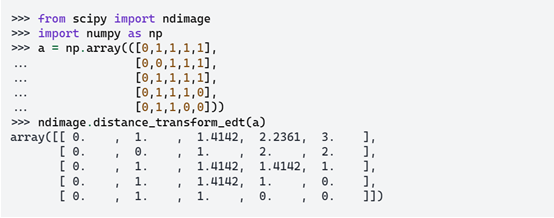
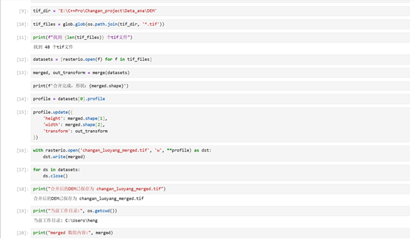
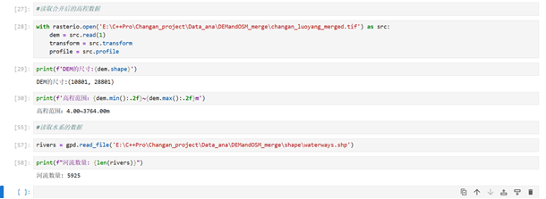
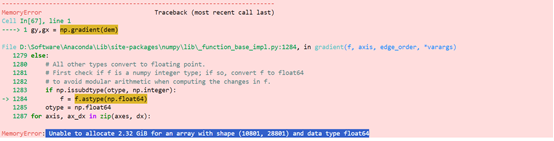
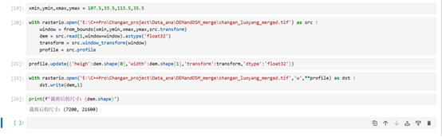

## Data Analysis Notes

---
**数据分析**

### 1、所用到的库
《python地理空间指南分析》p125
#### 1、GDAL、rasterio库处理栅格数据；
##### （1）更高级的封装库rasterio;
Rasterio库通过封装GDAL库的功能，提供了快速读取栅格数据的能力。Rasterio使用Python中的上下文管理器( with 语句)来打开数据集，在操作完成后自动关闭文件，保证了资源的有效管理。Rasterio读取栅格数据的基本原理是将文件映射到内存，然后通过读取内存中的数据来获取栅格信息。
##### (2)安装rasterio;
Pip install rasterio
##### （3）rasterio.features.rasterize 
是一个用于将矢量数据转换为栅格数据的函数。它可以将几何形状“烧录”到栅格中，并生成与输入矢量数据对应的栅格图像。
##### （4）rasterio.windows.from_bounds 
是 Rasterio 提供的一个实用函数，用于根据地理坐标范围（bounding box）计算对应的 Window（像素行列范围），方便只读取或写入栅格数据的某个子区域，而无需加载整个文件到内存。
#### 2、库和函数
##### （1） os 
 os 是 Python 中用于导入标准库模块 os 的语句。os 模块提供了与操作系统交互的功能，允许你执行文件和目录操作、环境变量管理等任务。
##### （2）Glob
Glob模块是Python的标准库模块，主要用于文件查找。
glob.glob()：此方法返回所有匹配的文件路径列表。它接受一个路径字符串参数，可以是绝对路径或相对路径。
##### （3）GeoPandas
GeoPandas 是由 Shapely、Fiona、PyProj matplotlib、Descartes 以及其他必须的库一同构建的 Pandas 的地理空间扩展。 
GeoPandas 是基于 Pandas 和 Shapely 的 Python 库，专为处理矢量地理数据（点、线、多边形）而设计，支持空间分析、坐标转换和可视化等功能。其核心数据结构 GeoDataFrame 在 DataFrame 基础上增加了 geometry 列，用于存储几何对象，并与属性数据统一管理。 

安装：Pip install geopandas -i https://pypi.tuna.tsinghua.edu.cn/simple   
或者conda install -c conda-forge geopandas 
##### （4）SciPy.ndimage
SciPy.ndimage是一个Python库，提供了一系列用于多维图像处理的功能。这个库是SciPy的一部分，一个用于科学计算的Python库，用于解决数学、科学、工程领域的问题。此函数通过将每个前景（非零）元素替换为其到背景（任何零值元素）的最短距离来计算输入的距离变换。

distance_transform_cdt — SciPy v1.18.0 Manual 
distance_transform_edt函数  
distance_transform_edt(input, sampling=None, return_distances=True, return_indices=False, distances=None, indices=None)  

### 案例：



坐标之间的距离，（0,2）（1,1）勾股定理1.4142.
##### （5）计算梯度
NumPy 库提供了一个非常有用的函数np.gradient，用于计算数组中元素的梯度。梯度是一个向量（或者在一维情况下是一个数值），指示函数在每个点上最陡峭的上升方向。   
梯度计算是通过分析函数在各个方向上的变化率来完成的。在一维数组中，梯度简单地表示为相邻点之间的差异。在多维数组中，梯度则是每个维度上的变化率的集合。例如，对于二维数组，梯度将包含两个数组，分别代表行和列方向上的变化率。  
np.gradient 函数接受以下参数：   
f：输入数组，可以是任意维度的 NumPy 数组。   
varargs：可选参数，用于指定沿各个维度的间距。如果未指定，NumPy 默认所有维度的间距为1。   
edge_order：可选参数，用于指定边界点的梯度计算方法。可以是1或2，其中1表示使用一阶差分，2表示使用二阶差分。   
axis：可选参数，用于指定需要计算梯度的轴。默认情况下，梯度将针对所有轴计算。   
函数返回的是一个数组或数组列表，这取决于输入数组的维度。每个数组代表对应维度上的梯度。   
##### （6）numpy.ones_like 
NumPy 库中的一个函数，用于创建一个与给定数组形状和类型相同的新数组，但新数组的所有元素都是 1。这个函数在需要初始化与现有数组形状和类型相同的全 1 数组时非常有用，例如在变量初始化、占位符数组设置或数学计算中。

### 2、数据整理
#### （1）合并高程数据模块



### 3、数据读取
读取高程数据和水系数据（暂时读取线状水系，不包含湖泊水库等面状水域）



### 4、计算坡度并构建成本面
#### （1）裁剪高程图
在计算坡度的时候发生内存爆满的情况，无法进行计算，究其原因是之前在提取长安-洛阳之间的DEM数据的时候范围过大导致，为了缩小计算量，必须对原高程图进行缩减也裁剪；其具体见“高程图裁剪算法说明”；  
报错：  



截取部分，降低数据集 
import rasterio 
from rasterio.windows import from_bounds 

#### (2)精确的研究区范围。
```python
xmin, ymin, xmax, ymax = 107.5, 33.5, 113.5, 35.5
with rasterio.open('changan_luoyang_merged.tif') as src:
    window = from_bounds(xmin, ymin, xmax, ymax, src.transform)
    dem = src.read(1, window=window).astype('float32')
    transform = src.window_transform(window)
    profile = src.profile
profile.update({
    'height': dem.shape[0],
    'width': dem.shape[1],
    'transform': transform,
    'dtype': 'float32'
})
with rasterio.open('changan_luoyang_corridor.tif', 'w', **profile) as dst:
    dst.write(dem, 1)
print(f"裁剪后尺寸: {dem.shape}")
```
代码示例：

 

#### （3）计算梯度 

见下一主题 

